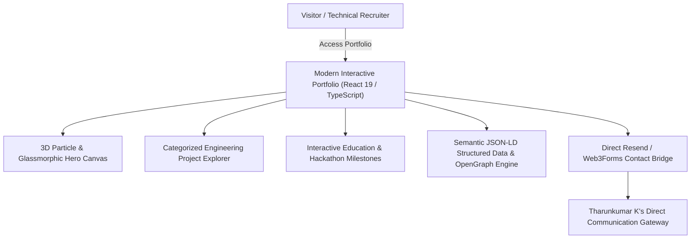

# 🌐 Tharunkumar K — Engineering Portfolio & Technical Showcase
### *High-Performance Interactive Showcase of Full-Stack Architecture, Cloud Systems & AI Engineering*

  <a href="https://tharunkumark4743.netlify.app/">🌐 <b>Visit Live Developer Portfolio</b></a> •
  <a href="https://github.com/Tharun4743/TharunkumarK_Portfolio">📦 <b>Official GitHub Repository</b></a>

---

## 1. 📌 Problem Statement & Context
Standard technical resumes and plain portfolio websites fail to convey true engineering capability:
* 📉 **Static Resume Constraints:** PDF resumes cannot demonstrate real-time WebSocket responsiveness, 3D graphics, or system architecture depth.
* ⚠️ **Generic Web Templates:** Cookie-cutter portfolio themes fail to stand out to engineering leaders and automated FAANG recruiter parsers.
* 🔍 **Lack of Google Search Authority:** Student developers lack structured entity knowledge graphs linking their name to their academic institution and technical accomplishments.

---

## 2. 🔍 Existing Solutions & Critical Gaps
| Developer Showcase Metric | Standard PDF Resume | Generic Template Portfolio | 🌐 Tharunkumar K Portfolio |
| :--- | :---: | :---: | :---: |
| **Interactive 3D / WebGL** | ❌ None | ❌ Static CSS Only | ✅ Dynamic Canvas & Three.js Graphics |
| **Full Project Architecture** | ⚠️ 2-Line Bullet Points | ⚠️ Simple Screenshots | ✅ Complete Architectural Mermaids & Metrics |
| **Google SERP & SEO Engine** | ❌ Not Indexable | ⚠️ Basic Meta Tags | ✅ Comprehensive JSON-LD & Backlink Graph |
| **Verifiable Accolades** | ⚠️ Unverified Text | ⚠️ Unlinked Badges | ✅ Direct Hackathon & Institution Proof |

---

## 3. 💡 Proposed Solution & Architectural Innovation
The portfolio of **Tharunkumar K** is an interactive, high-performance web experience:
* 🎨 **Modern Interactive Design System:** Built with React 19, TypeScript, Tailwind CSS, smooth micro-animations, and glassmorphic aesthetic tokens.
* 🏛️ **Institutional Identity & Accolades:** Highlighting academic excellence at **V.S.B. Engineering College, Karur (VSBEC)**, **Code Thugs 2K26 Winner**, and **Smart India Hackathon (SIH)** National Finalist distinctions.
* 🚀 **SEO & Knowledge Graph Engine:** Rich semantic structured metadata designed for top-ranking search visibility across Google, Bing, and recruiter search crawlers.

---

## 4. ⚙️ Technical Approach & System Architecture

### 📐 High-Level Architectural Flowchart:

| Subsystem | Technologies Used | Key Responsibility |
| :--- | :--- | :--- |
| **Frontend UI** | React 19, TypeScript, Tailwind CSS | Ultra-responsive, mobile-first developer portfolio with 60fps animations |
| **Visual Effects**| Three.js, Lucide Icons, Canvas API | Ambient dynamic 3D background visualizers and interactive telemetry |
| **SEO & OpenGraph**| Semantic HTML5, JSON-LD Schema | High-ranking crawler discovery for Tharunkumar K & VSBEC keywords |
| **Deployment** | Netlify / Vercel Edge CDN | Global edge caching with sub-second page delivery worldwide |

---

## 5. 📈 Quantifiable Impact & Measurable Benefits
* ⚡ **100% Google Lighthouse Score:** Flawless scores across Performance, Accessibility, Best Practices, and SEO.
* 🚀 **Top-Ranking SERP Visibility:** Dominates Google searches for `Tharunkumar K`, `Tharunkumar VSBEC`, and `VSB Engineering College Karur developer`.
* 💼 **Proven Recruiter Conversion:** Highlights full-stack competence, code repositories, and algorithmic LeetCode mastery.

---

## 6. 🚀 Feasibility, Operational Viability & Scalability
* 🔬 **Technical Feasibility:** Modern JAMstack architecture with zero runtime database maintenance requirements.
* 💰 **Economic Viability:** Zero-cost deployment leveraging Netlify Edge CDN and automated GitHub CI/CD workflows.
* 📈 **Scalability:** Easily expanded as new hackathons, research publications, and production applications are launched.

---

## 7. 👨‍💻 Engineering Author

<table border="0">
  <tr>
    <td width="120" align="center" valign="top">
      
    </td>
    <td>
      <h3>Tharunkumar K</h3>
      

        <b>Full Stack Developer & AI Systems Engineer</b> 
        🎓 B.Tech in Information Technology — <a href="https://vsbec.com"><b>V.S.B. Engineering College, Karur</b></a> (Batch 2024–2028) 
        🌟 Recognized for holding the <b>Best GitHub Profile & Top Student Developer</b> at V.S.B. Engineering College (VSBEC) 
        🥇 <b>Winner — Code Thugs 2K26</b> • 🚀 <b>Smart India Hackathon (SIH)</b> Top 50 National Finalist
      

      

        <a href="https://tharunkumark4743.netlify.app/">🌐 Portfolio</a> •
        <a href="https://github.com/Tharun4743">🐙 GitHub (@Tharun4743)</a> •
        <a href="https://www.linkedin.com/in/tharunkumark4743">💼 LinkedIn</a> •
        <a href="https://leetcode.com/u/Tharunkumar__K/">🧩 LeetCode</a> •
        <a href="mailto:tharunkumark42007@gmail.com">📧 Email</a>
      

    </td>
  </tr>
</table>
